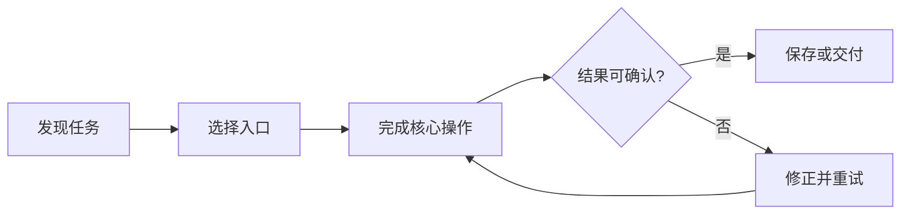

# AI 产品知识手册

把一次模糊需求变成可交付产品，需要同时处理用户问题、证据、交互、工程约束和上线反馈。这份手册整理了一条适合小团队的工作路径，方便在调研、设计和复盘时快速定位重点。

> 好的产品文档应该帮助团队做决定：现在解决什么，如何确认有效，哪些问题留到真实反馈出现以后。

## 1. 从用户问题开始

用户通常不会主动描述完整需求。他们会说“这里很难用”“每次都要重复操作”或“我找不到刚才的内容”。先还原任务发生的环境，再判断值得解决的问题。

### 1.1 三层证据

| 证据层级 | 需要回答的问题 | 常用材料 | 适合形成的输出 |
| --- | --- | --- | --- |
| 行为证据 | 用户实际做了什么，在哪一步停下 | 录屏、操作日志、任务观察 | 可复现的关键路径 |
| 语言证据 | 用户如何描述困扰与期待 | 访谈、客服记录、社区讨论 | 问题陈述与用户原话 |
| 结果证据 | 改动是否真正节省时间或减少错误 | 完成率、耗时、回访反馈 | 验收标准与迭代结论 |

### 1.2 一页问题定义

- [x] 说明目标用户和使用场景
- [x] 写清当前做法与主要阻力
- [ ] 找到能够观察的成功信号
- [ ] 标出本轮不处理的相邻问题

一页问题定义用于快速对齐。团队成员读完后，应该能独立复述用户为何需要这次改动。

## 2. 把方案变成可验证的路径

功能列表无法代替使用流程。把用户从进入产品到完成任务的每一步串起来，才能看到按钮放错位置、状态缺失和反馈过晚等问题。

### 2.1 最小验收表

| 阶段 | 用户动作 | 产品反馈 | 验收重点 |
| --- | --- | --- | --- |
| 进入 | 打开已有内容 | 保持上次位置与状态 | 无需重新寻找 |
| 操作 | 修改一个关键对象 | 光标、选区和工具同步 | 操作连续、结果可见 |
| 保存 | 明确提交修改 | 状态变为已保存 | 原内容安全、失败可恢复 |
| 重开 | 再次进入同一内容 | 回到合理阅读位置 | 关键状态没有丢失 |

## 3. 用优先级保护交付节奏

时间有限时，优先围绕完整路径安排工作。一个可以从头走到尾的窄流程，通常比许多互不连接的功能更有价值。

### 必须现在完成

1. 核心任务能够完整结束。
2. 错误不会导致内容丢失。
3. 高频入口清楚、状态可信。
4. 用户可以自行恢复常见失败。

### 收到真实反馈后再做

- 更细的个性化设置
- 面向少数格式的额外适配
- 自动化程度更高的批量能力
- 需要持续运营的新入口

## 4. 从反馈回到下一轮

一次发布的价值取决于后续学习。记录用户遇到的真实问题，用相同任务再次验证，逐步缩短完成时间与理解成本。

设某一步的完成率为 $p$，连续经过 $n$ 个关键步骤后，整条路径的理论完成率可以粗略写为：

$$
P_{journey}=\prod_{i=1}^{n}p_i
$$

这也解释了为什么每个“小摩擦”都会累积。优化时先修复完成率最低、影响人数最多的步骤，再观察整条路径是否改善。

### 发布前检查

- 核心流程由真实操作验证
- 空状态、失败状态和恢复入口均可理解
- 文案描述用户任务，不描述实现过程
- 视觉层级在常用窗口尺寸下保持稳定
- 保存、重开与外部变化不会造成内容丢失

---

持续迭代的目标很简单：让用户更快完成真正重要的事情，并且相信每一步结果。
