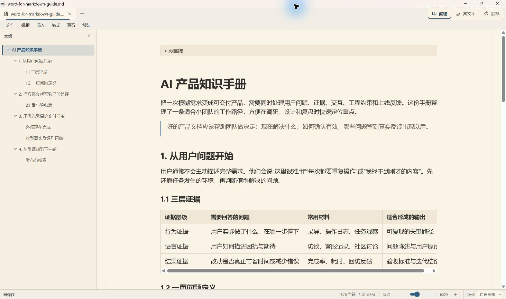
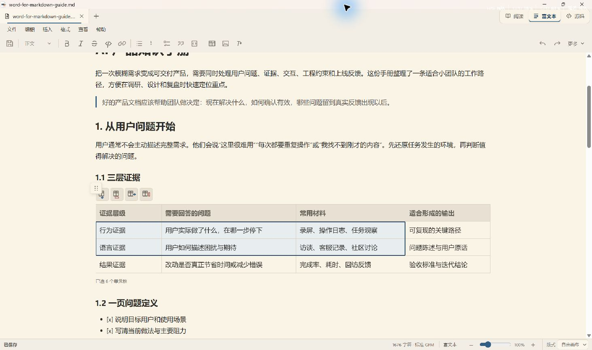
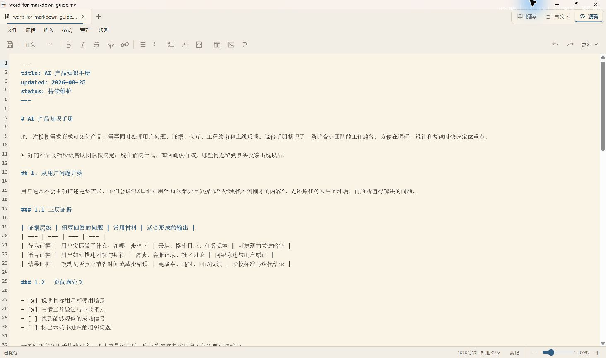

<p align="right"><a href="README.md">简体中文</a> · English</p>

<p align="center">
  
</p>

<h1 align="center">Word for Markdown</h1>

<p align="center"><strong>Open, read, and edit local Markdown like a document.</strong></p>

<p align="center">
  <a href="https://github.com/CheaperjamRen/Word-for-Markdown/releases/latest"><strong>Download for Windows</strong></a>
  · Windows 10/11 x64
  · 简体中文 / English
  · Apache-2.0
</p>



## Markdown is becoming a common document format for AI work

Markdown expresses headings, lists, links, tables, and code in plain text. Files stay small, open quickly, and remain readable in any text tool. Git can track changes precisely, and long-term access does not depend on one document platform.

It also fits the way AI agents work. An agent can generate, read, and revise structured Markdown reliably, while the source remains understandable to people. The same `.md` file can move between agents, repositories, documentation sites, and cloud editors. [Google Docs](https://support.google.com/docs/answer/12014036), [Notion](https://www.notion.com/help/import-data-into-notion), and [Lark Docs](https://www.feishu.cn/content/article/7644456827538820052) now offer ways to import, export, or open Markdown.

### Local reading still lacks a natural default

Markdown already moves well between tools, but the Windows desktop experience remains fragmented. Agent previews stay tied to the original conversation, code editors emphasize source and project workflows, and cloud imports often create another copy. A local file needs a simple default action: double-click the `.md`, start reading, and edit it in place when necessary.

Word for Markdown completes that local workflow. It opens `.md` and `.markdown` files as comfortably typeset documents, with Rich Text and Source modes one click away. Menus, tabs, the toolbar, and keyboard shortcuts follow familiar desktop document conventions.

> A Windows document app that makes an Agent-produced Markdown file feel as natural to open as a DOCX file.

## What makes it different

| | |
| --- | --- |
| **Long-form reading first** | Comfortable line length and spacing, plus an outline, document search, Focus Reading, and saved reading position. |
| **One document, three views** | Reading, Rich Text, and Source share the current content and zoom state. Switching views never saves the file. |
| **Markdown source stays intact** | Rich editing writes back only the areas you changed. Unsupported syntax keeps its source and remains available through a local source editor. |
| **Local files with explicit saving** | Documents stay on your computer. The original file changes only when you save, and recovery drafts protect unfinished edits. |

### A reading surface for handbooks and agent deliverables

- Soft White, Warm Paper, and Night themes across the application
- Narrow, Medium, and Wide text widths with three spacing levels
- A4 Portrait, A3 Wide, and Canvas layouts
- Whole-canvas zoom and text-size zoom
- Nested outline, `Ctrl+F`, anchors, and local Markdown navigation
- GFM tables and task lists, code blocks, images, KaTeX equations, and Mermaid diagrams

### Familiar Rich Text editing with an open Markdown source

Edit continuously across the document and use headings, bold, italic, strikethrough, inline code, lists, quotes, links, and code blocks. Tables support rectangular selection, row and column operations, direct cell editing, and block movement. Equations, diagrams, and specialized blocks retain a clear route back to their source.



### Precise control in Source mode

Source mode uses CodeMirror 6 with line numbers, Markdown highlighting, find and replace, and virtualization for large documents. Rich Text and Source editing update the same in-memory candidate; the original file is written only when you choose Save or press `Ctrl+S`.



## Everyday workflow

1. Open the app and choose **Open Document**, or continue from **Recent Documents**.
2. Switch between **Reading**, **Rich Text**, and **Source** in the top-right mode control.
3. Choose A4, A3, or Canvas from the status bar and adjust document zoom.
4. Enter Focus Reading from the View menu when you want a quieter page.
5. Press `Ctrl+S` when you are ready to save.

Web links open in the default browser, local Markdown opens in another tab, and supported local resources such as images stay inside the app. If another program changes the file, Word for Markdown refreshes a clean document or asks which version to keep when local edits are present.

## Download and install

Go to [Releases](https://github.com/CheaperjamRen/Word-for-Markdown/releases/latest) and download `Word-for-Markdown_0.1.0_x64-setup.exe`.

The installer supports Simplified Chinese and English and installs for the current Windows user. You can open files from inside the app or select it as the default Windows application for `.md` and `.markdown` files. The English interface displays “Markdown Document.”

This public preview does not yet use a commercial code-signing certificate. If Windows shows an unknown-publisher warning, first confirm that the installer came from this repository's Releases page and compare its SHA-256 with the value listed in the release notes.

## Files and privacy

- No account is required, and documents do not need to be uploaded to a cloud service.
- Theme, layout, zoom, and interface language stay in local application settings and never enter the Markdown file.
- The original Markdown bytes remain the document source of truth. Before an explicit save, edits stay in the current session and its recovery draft.
- The app checks the on-disk version before saving. When external and local changes conflict, you choose which version to keep.

## Current scope

v0.1.0 focuses on local `.md` and `.markdown` files on Windows 10/11 x64. Standard GFM is the default document profile, with reading and safe editing paths for equations, Mermaid, and frontmatter. Less common extensions that cannot be converted safely remain available as source in Source mode or the local block source editor.

## Build from source

<details>
<summary>Show build instructions</summary>

You will need Node.js 20+, stable Rust, Microsoft C++ Build Tools, and the WebView2 Runtime.

```powershell
npm ci
npm run verify
npm run tauri:build
```

The Windows installer is written to `src-tauri/target/release/bundle/nsis/`.

</details>

## License

[Apache License 2.0](LICENSE)
