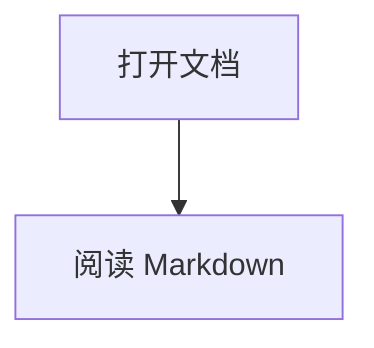

# Markdown 功能示例

这是用于验证本地 Markdown 渲染路径的基础文档，包含标准 GFM、数学公式与图表。

- [x] 打开本地文档
- [ ] 验证保存路径

| 能力 | 状态 |
| --- | --- |
| GFM | 可用 |
| 数学公式 | 可用 |

质能方程是 $E = mc^2$。

$$
\int_0^1 x^2\,dx = \frac{1}{3}
$$

```ts
const documentName = "markdown-showcase.md";
```

[网页](https://example.com) · [下一篇文档](./next.md)


